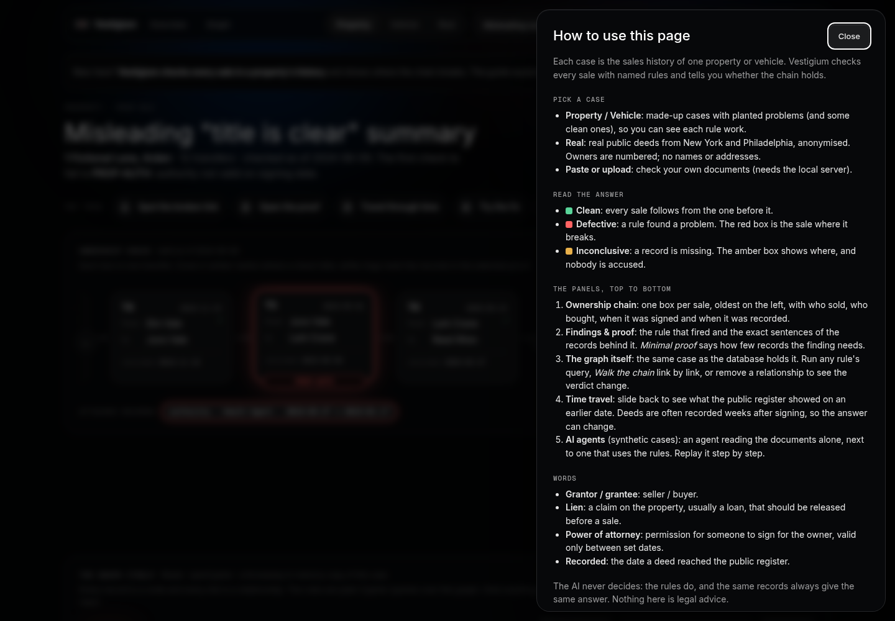
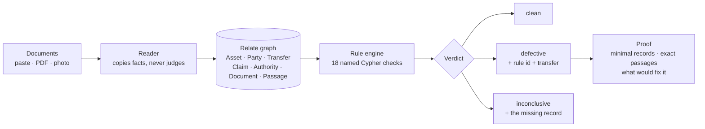
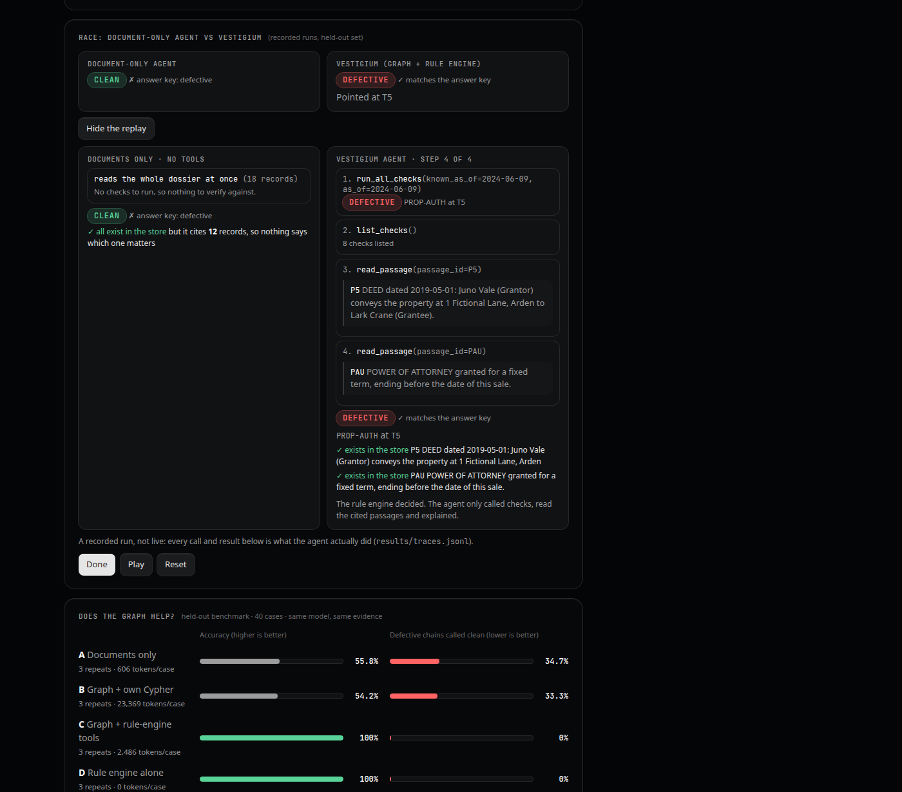
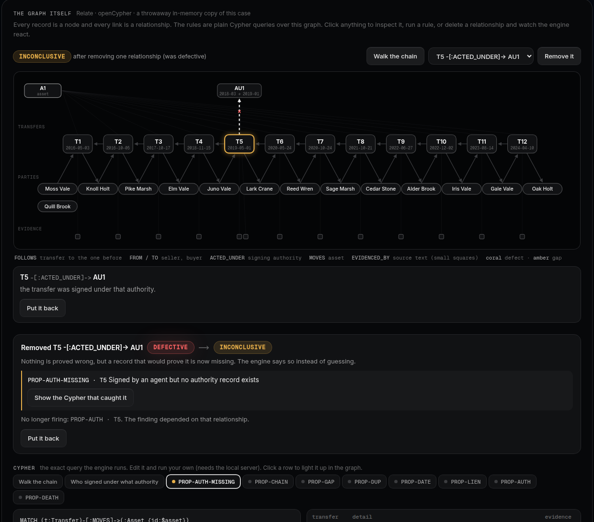

# Vestigium

**Before you buy a house or a car, check that every past sale was valid, and see exactly which record proves it.**

Vestigium takes the paperwork behind a property or a vehicle (deeds, titles, liens, powers of attorney), rebuilds its ownership history as a graph, and checks every sale with clear, named rules. It answers *clean*, *defective* or *inconclusive*, and points at the exact record behind the answer. Built on [Relate by Neo4j](https://relatedb.ai).


**Try it now, no install:** <https://vestigium-demo.vercel.app/> · the app: <https://vestigium-demo.vercel.app/app.html>

> The benchmark uses **synthetic** (made-up) records. The engine is also tested on **30,803 real, public deeds** from New York and Philadelphia, anonymised here. Nothing here is legal advice.

---

## In 30 seconds

- **The problem.** A chain of sales can look fine document by document and still be broken: a seller who never owned the property, a deed signed under an expired power of attorney, a loan on the property that was never paid off, a car's salvage history quietly dropped.
- **What Vestigium does.** It checks every sale against the one before it, and against the authority and claims around it, using 18 plain rules written as graph queries.
- **What you get.** A verdict, the rule that decided it, the sale where it breaks, and the smallest set of records that proves it. If a record is missing it says *inconclusive* and names the missing record, instead of guessing.
- **Where AI fits.** An AI may *read* documents into facts (and shows you everything it read). It never decides. The rules decide, and the same records always give the same answer.

| Verdict | What it means |
|---|---|
| **clean** | every sale follows from the one before it, and no rule finds a problem |
| **defective** | a rule found a problem; you see which rule, which sale, and the records that prove it |
| **inconclusive** | a record that should exist is missing; you see which one, and no one is accused |

## How to use it

### 1. In your browser (no install, 2 minutes)

Open **<https://vestigium-demo.vercel.app/app.html>**. It starts on one question: **would you buy this property?** The header answers it ("No, not on this evidence. The chain breaks at T5, and 7 later sales rest on it"), and the **Investigate** buttons walk you through how it knows:

1. **Where does it break?** Each box is one sale; the red one is where a rule failed, and the striped ones after it rest on it.
2. **What proves it?** The rule, the exact sentences of the records behind it, and how few records that took.
3. **Was the signer allowed?** Every question about the power of attorney, each with ✓ or ✗.
4. **What else does it break?** The later sales whose chain of title passes through the broken one.
5. **What could you have known?** The two kinds of time: here, the broken sale was signed on 1 May but filed on 4 May, so anyone checking in between was told *clean*.
6. **What would fix it?** The record that would make the chain sound, tested on a copy of the graph.
7. **Break a link in the graph**: remove one relationship and watch the verdict change.

Then switch to the **Real** tab to browse real, anonymised deeds from New York and Philadelphia.

Use the **Property / Vehicle / Real** switch and the case picker to explore other cases. Press **?** in the app for a short guide to every panel.



### 2. On your own documents (local)

```bash
git clone https://github.com/samuel025/vestigium && cd vestigium
uv sync                                   # installs everything (Python 3.12+, uses uv)
cp .env.example .env                      # optional: add a free GEMINI_API_KEY to read messy text, PDFs and photos
uv run python -m vestigium.serve          # then open http://127.0.0.1:8000/app.html
```

Click **Paste or upload**, then paste the text of your deeds (one record per paragraph) or upload PDFs or photos, and press **Check this dossier**. You get the same view as the demo cases, plus a list of every fact the reader extracted so you can check it against your documents. Without an API key, the offline reader handles text written in the demo's wording ("Load a clean sample" shows it).

### 3. From your own AI assistant (MCP)

```bash
claude mcp add vestigium -- uv run --directory /path/to/vestigium python -m vestigium.mcp_server
```

Then ask *"Use vestigium to check the dossier for prop-014 and explain the verdict."* Your assistant reads the documents; Vestigium's rules decide. Details in *Use it from your own agent (MCP)* below.

### 4. Check our claims

```bash
uv run pytest -q                          # 70 tests, no network needed
uv run python -m vestigium.cli prop-014   # one case in the terminal: verdict, rule, evidence, fix, timeline
uv run python -m vestigium.metamorphic    # 1,600 fresh cases + invariance checks
uv run python -m vestigium.philly fetch --n 10000 && uv run python -m vestigium.philly   # the real Philadelphia test (~8 min)
```

### Words you will see

| Word | Meaning |
|---|---|
| **Chain** | the list of sales of one property or vehicle, oldest first |
| **Grantor / grantee** | the seller / the buyer on a deed |
| **Lien** | a claim on the property, usually a loan; it should be released before a sale |
| **Power of attorney** | written permission for someone to sign for the owner, valid only for set dates |
| **Recorded** | the date the deed reached the public register, often weeks after it was signed. Every fact here has both dates |
| **Rule** | one named check, e.g. `PROP-CHAIN` (the seller must be the previous buyer). All 14 are listed below |

## How it works



1. **Documents.** Paste text, upload a PDF, or photograph a deed (stamps, handwritten notes and blur included).
2. **Reader.** An offline regex reader handles canonical wording; a language model handles anything else; a vision model reads scans, and every scan is read a second time so that any date or name the two reads disagree on is flagged for a person to check.
3. **Graph.** Facts land in one Relate graph: `Asset`, `Party`, `Transfer`, `Claim`, `Authority`, `Document`, `Passage`, linked by `FROM`, `TO`, `MOVES`, `FOLLOWS`, `AGAINST`, `CLEARED_BY`, `ACTED_UNDER`, `EVIDENCED_BY`, and more. **Every fact carries two dates**: when it took effect and when it was recorded.
4. **Rule engine.** Eighteen named Cypher checks (twelve for property, six for vehicles). Gap rules produce *inconclusive*; the rest produce *defective*.
5. **Proof.** The verdict comes with its trail: verdict → rule id → graph path → evidence → exact document passage, the *smallest set of records* it rests on, and *what record would fix it*.


## Why Relate, and why single-file mode

Ownership is a chain of *relationships*: who gave up the asset, who received it, what authority the signer had, which claim was open. "Was the grantor the previous grantee?" and "was a lien released before this sale?" are graph patterns, so each rule is a short Cypher query on Relate, and the app lets you see exactly that: the graph itself, each rule's query, and what happens when you delete a relationship (see *The graph, live*). We store the demo graph in single-file mode, `vestigium.rl`: persistent, one file a judge can open and inspect, no server. Each benchmark case is built in its own in-memory graph, so every case is isolated, and "what would fix it" copies a graph into a throwaway instance to rehearse a hypothetical record.

## Running it locally: details

See *How to use it* above for the commands. Inspect the persistent store with any Relate client:

```python
import relate; db = relate.connect("vestigium.rl")
db.execute("MATCH (t:Transfer)-[:ACTED_UNDER]->(a:Authority) RETURN t.id, a.agent, a.valid_to").data()
```

Everything runs offline except the LLM parts (benchmark arms A to C, the Gemini reader, scan reading) and the one-off download of the real NYC records. `uv run python -m vestigium.serve` serves the UI, the paste and upload endpoints, and the graph lab's custom-query endpoint; `cd demo && python3 -m http.server 8000` serves the static pages only.

## What you can do with it


| | |
|---|---|
| **Verdicts with a proof trail** | verdict → rule id → graph path → evidence → exact passage, in the UI and over MCP |
| **What else it breaks** | when a sale fails, every later sale whose chain of title passes through it is marked *rests on T5*: one graph walk over `FOLLOWS`, shown in the chain, the proof panel and the graph |
| **Minimal proof** | the smallest set of records a finding rests on (1.8 of a 10.3-record dossier on average) |
| **The graph itself** | the real nodes and relationships, a Cypher console with the exact rule queries (and your own, read-only), a chain walk, and *remove a relationship* to watch the verdict change |
| **Two kinds of time** | two separate controls: *legally true on* (which sales had been signed) and *known on* (which deeds had reached the register), plus a grid of the verdict for every pair of dates. E.g. on `prop-014` the broken sale was signed on 1 May but filed on 4 May: legally defective, yet an investigator checking in between was told *clean* |
| **What would fix it** | copy the graph, add a hypothetical record (a release, a ratifying authority, a missing link), rerun every check |
| **Honest "inconclusive"** | a missing record is named, never guessed |
| **Paste a dossier** | any wording; a reader extracts, the rules decide; every extracted fact is listed to check |
| **Scanned documents** | PDFs and photos, read twice; a record the two reads disagree on is flagged, and the verdict names the page to check |
| **Real records** | the unchanged engine on 30,803 real deeds from New York and Philadelphia (about 10,000 properties), every kind of flag explained, browsable in the app |
| **Replay the investigation** | real agent transcripts, tool call by tool call, with every citation checked against the store |
| **MCP server** | any MCP client can send records and get a verdict, rule ids and exact cited text |



**Rule packs** (`vestigium/rules.py`): *Property*: PROP-CHAIN, PROP-DUP, PROP-LIEN, PROP-AUTH, PROP-AUTH-PRINCIPAL, PROP-AUTH-SCOPE, PROP-AUTH-REVOKED, PROP-AUTH-SIGNER, PROP-DATE, PROP-DEATH, PROP-GAP, PROP-AUTH-MISSING. *Vehicle*: VEH-OWN, VEH-LIEN, VEH-BRAND, VEH-ODO, VEH-GAP, VEH-ODO-MISSING.

### Power of attorney, in depth

Most chains break where someone signs *for* the owner. Vestigium asks every question a title examiner would about that power of attorney, each as its own rule on the graph:

| Rule | The question | Graph pattern |
|---|---|---|
| `PROP-AUTH` | Was it in force on the signing date? | the sale's date against the authority's `valid_from` / `valid_to` |
| `PROP-AUTH-PRINCIPAL` | Did the **seller** grant it? | `(authority)-[:GRANTED_BY]->(person)` must be the seller `-[:FROM]->(sale)` |
| `PROP-AUTH-SCOPE` | Does it cover **selling**, not just managing? | the authority's `scope` |
| `PROP-AUTH-REVOKED` | Was it **revoked** before the signing? | `(authority)-[:REVOKED_BY]->(revocation)`, dated before the sale and on file by the date you ask about |
| `PROP-AUTH-SIGNER` | Did the agent it names actually **sign**? | the sale's `signer` against the authority's `agent` |
| `PROP-AUTH-MISSING` | Is there an authority at all? | an agent-signed sale with no `ACTED_UNDER` (inconclusive, not defective) |

A defect fires only when **no other** authority on the sale answers every question (one shared Cypher condition), so a ratification fixes it. A revocation has two dates too: one signed before the sale but filed after it is invisible to an investigator at the sale and appears once filed, which the *Two kinds of time* grid shows. The app's case picker has a **Power of attorney, in depth** group (18 cases: 3 of each defect, 2 late-filed revocations, 4 valid agent sales that look risky); clicking an agent-signed sale, or *Walk the chain*, lists each question with ✓ or ✗. These cases were written after the 80-case benchmark and are not part of its held-out split; the new rules change no verdict on those 80 (tested).

### The graph, live



The app shows the case as the graph Relate actually holds. Click any transfer, party or line to inspect it; **Walk the chain** traverses `FOLLOWS` from the newest transfer back to the root, checking each link and each signing authority. Every rule has a tab with its exact Cypher and the rows it returns on this case; click a row to light up the nodes it matched. You can edit a query and run your own (read-only, on a throwaway in-memory copy; needs `uv run python -m vestigium.serve`).

The strongest demo: select a `FOLLOWS`, `ACTED_UNDER` or `CLEARED_BY` line and **remove it**. On a clean chain, dropping one `FOLLOWS` makes `PROP-GAP` fire and the verdict turns *inconclusive*; on `prop-014`, dropping the authority link replaces the `PROP-AUTH` defect with `PROP-AUTH-MISSING`. The engine reports what is now missing instead of guessing. Outcomes for every removable relationship of all 80 cases are precomputed, so this works on static hosting too. Deep links: `app.html?case=prop-014&remove=T5>ACTED_UNDER>AU1`, `&walk=1`, `&graph=1`, `&tab=rule:PROP-GAP`.

## Benchmark

80 synthetic cases from a fixed seed (`vestigium/generator.py`): **60 property** (40 defective incl. 5 adversarial, 10 clean, 10 inconclusive) and
**20 vehicle** (12 defective, 4 clean, 4 inconclusive). Chains run 3–12 transfers with distractor documents; the hard tier includes expired powers of attorney
and a misleading "title is clear" summary. Every third property case plus all vehicle cases (**40**) are the **held-out** set that the headline numbers use.
The answer key is `answer_key.json`; the planted error for each case is listed there.

Four arms, same evidence, same model (`gemini-3.5-flash-lite`, temperature 0.2):

- **A** original documents only, no graph.
- **B** documents as a Relate graph; the agent writes its own read-only Cypher.
- **C** the full system: Relate graph + the rule engine's checks as tools.
- **D** the rule engine alone, no agent.

### Results (held-out, 40 cases)

| Arm | Repeats | Accuracy (mean ± spread) | False-clean¹ | Abstains correctly | Localizes defect | Fix type | Tokens / case |
|---|---|---|---|---|---|---|---|
| A: documents only | 3 | 55.8% ± 1.2 | 34.7% ± 1.9 | 14% | 0% | 27% | 606 |
| B: graph + own Cypher | 3 | 54.2% ± 6.2 | 33.3% ± 11.5 | 5% | 46% | 64% | 23,369 |
| C: graph + rule tools | 3 | 100% ± 0 | 0% | 100% | 100% | 100% | 2,486 |
| D: rules alone | 3 | 100% ± 0 | 0% | 100% | 100% | 100% | 0 |

¹ share of *defective* cases called clean, the worst error. Spread is the standard deviation of per-repeat accuracy. Citation validity: A 92%, B 87%, C 100%, D 100%.
Property and vehicle show the same pattern (A 55% / 57%, B 58% / 50%, C and D 100% / 100%). Raw answers, tool-call counts and tokens for every run are in `results/heldout.jsonl`; full transcripts (every tool call, its arguments and result) are recorded for 12 showcase cases in `results/traces.jsonl`.

**Reading it:** a graph by itself did not help (B is no better than A, at ~39× the tokens, and swings from 47.5% to 62.5% between repeats). Giving the agent the rule engine's checks did (A 56% → C 100%, false-clean 35% → 0%),
and it did so in every repeat. C matches D on every verdict; the agent's contribution is investigation and explanation, which this benchmark does not score.

### Paste a dossier: reading documents into the graph

The UI's **Paste a dossier** box takes deeds, titles, liens, powers of attorney, releases and death certificates, extracts the facts, and hands them to the same rule engine
(`vestigium/intake.py`, `extract.py`, `dossier.py`). The reader only *reads*: it never decides legality, every verdict still comes from the rules, and the extracted facts are listed
so a person can check them. Nothing that could not be read is called clean: an empty chain is *inconclusive* ("no ownership records could be read").

We score this stage too (`vestigium/intake_bench.py`, held-out 40 cases, 3 repeats). Dossiers are rendered from the gold graph with every fact stated in text; "messy" wording varies date formats,
abbreviates names ("G. Stone") and shuffles record order. The reader's output is rebuilt into a graph, the engine judges it, and the result is compared with the gold graph.

| Reader | Wording | Verdict accuracy | Defective called clean | Right finding at the right record | Records read exactly |
|---|---|---|---|---|---|
| Offline regex | canonical | 100% | 0% | 100% | 100% |
| Offline regex | messy | 17.5% | 2.7% | 2.5% | 5.4% |
| Gemini (`gemini-3.5-flash-lite`) | canonical | 100% | 0% | 100% | 100% |
| Gemini | messy | 100% | 0% | 100% | 99.6% |

What to take from it: wording variety breaks a pattern-matching reader, and a language model recovers it, with the rule engine still making the call. Honest caveats: the dossiers are synthetic and generated from the same
schema, so real scanned deeds would be harder (OCR noise, free-form clauses); a name that is only ever abbreviated in a dossier stays abbreviated, which is correct to copy and the scorer accepts.
We changed the extraction prompt once after seeing results on this same held-out set (the first prompt let the model invent a first name for "N. Stone", which wrongly broke 2 of 120 messy runs; we now tell it to copy
names exactly and let code match abbreviations). The first run is kept in `results/intake_v1_prompt.jsonl` (98.3% messy verdict accuracy). Raw runs, including each extracted record list, are in `results/intake.jsonl`.

### Scanned documents: PDFs and photos

Nobody types out a 20-page deed. The upload box (and `POST /api/scan`) accepts PDFs and JPEG, PNG or WebP photos (`vestigium/scan.py`). Stage 1 is a vision model that transcribes each page record by record, including clerk's stamps and handwritten notes, and reports a **confidence** (high, medium or low) with *what* it is unsure about. It copies; it never judges. Stage 2 sends the transcript through the same reader, graph and rule engine.

**Confidence is carried into the verdict.** If a finding rests on a record that was read with low confidence, the verdict card says which record and page to check against the original, instead of guessing silently. A CLEAN verdict with low-confidence records is warned about too, not presented as safe, and low confidence on an irrelevant record does not raise a false alarm. A record that looks like a deed or lien but cannot be parsed is never silently dropped: the verdict becomes *inconclusive* and names the unreadable record.

How we test it: `render_scan()` makes synthetic scans from our dossiers, in three tiers (a clean PDF, a phone photo with rotation, uneven lighting, blur and JPEG damage, and a poor photo), with the recording date appearing *only* as a red stamp or a handwriting-style note, as on a real recorded deed. "Try a sample phone photo" in the app renders one and reads it.

**Double read.** A model's own confidence proved unreliable on poor photos (below), so every scan is read **twice**: the second, independent read lists only each record's dates and names, and code compares the two. Any record where they disagree is marked low confidence, whatever the model said, and the verdict names the record and page to check. It is deterministic and does not depend on the model knowing it is wrong.

**Results** (`uv run python -m vestigium.scan_bench`, held-out 40 cases per tier, `gemini-3.5-flash-lite` for vision; raw rows in `results/scan_x2/` with the double read and `results/scan_lite/` with a single read):

| Tier | Verdict accuracy | Defective called clean | Right finding at the right record | Records with every date read exactly | Misreads flagged | Correct records flagged (false alarms) | Wrong verdicts with no warning |
|---|---|---|---|---|---|---|---|
| Clean PDF | 100% | 0% | 100% | 99.8% | 0 of 1 | 1 of 401 | 0 |
| Phone photo | 100% | 0% | 100% | 99.8% | 0 of 1 | 3 of 401 | 0 |
| Poor photo | 95.0% | **0%** | 87.5% | 98.8% | **3 of 5** | 10 of 397 | 2 |
| Poor photo, re-run after the reader fix below | 97.5% | 4.0% (1 case) | 92.5% | 98.8% | 2 of 5 | 9 of 397 | 1 |
| *Poor photo, single read* | *90.0%* | *4.0% (1 case)* | *82.5%* | *99.0%* | *0 of 4* | *–* | *4* |

**What this says, plainly.** Clean PDFs and ordinary phone photos read reliably. On poor photos the model's self-reported confidence caught **none** of its misreads; the double read caught 3 of 5 at the cost of flagging about 1 in 40 correct records, but it is **not a guarantee**: a misread both reads share is not caught. In the re-run, `prop-059` had two dates misread the same way by both reads and was called **clean** with no warning; in the run before, the same case came back defective with a warning. So on poor photos the worst error still happens, about 1 case in 40, and changes from run to run.

**A reader bug the scans exposed.** Two clean poor-photo cases (`prop-017`, `prop-056`) came back *inconclusive* in both earlier runs. No date was misread: the vision model dropped one word, reading "the chain of **title** begins here" as "the chain of begins here", and the offline reader recognised the first transfer only by that exact phrase, so it reported a gap at T1. It now accepts either sentence the record uses ("the first recorded transfer" or "the chain of title begins"), with a test. Both cases are correct in the re-run. This makes the reader tolerant of a lost word in *our* wording; real deeds do not use a fixed sentence, so it is not a general fix. Runs vary: the first read itself differs between runs, so compare the catch rate more than the verdict percentages. An earlier partial run with `gemini-3.5-flash` (33 clean-PDF cases, all correct) is in `results/scan.jsonl`; we switched because that model's free tier allows only 20 requests a day per key. Tested only on synthetic pages: true handwriting, real scanner noise, and dedicated OCR services (Google Document AI, AWS Textract) are untested.

### Use it from your own agent (MCP)

`vestigium/mcp_server.py` serves the engine over the Model Context Protocol, so Claude Desktop, Claude Code or any MCP client can investigate a chain. Your model *reads* the documents and sends structured
records; the server *decides* with the deterministic rule engine and returns the verdict, rule ids, and the exact text of every cited record. Tools are read-only and need no API key: `rules`, `list_cases`,
`read_dossier`, `check_case` (with `as_of` / `known` dates), and `check_records` (a dossier your model has read). Invalid input is rejected, not guessed at.

```bash
claude mcp add vestigium -- uv run --directory /path/to/vestigium python -m vestigium.mcp_server
# Claude Desktop: add {"command": "uv", "args": ["run", "--directory", "/path/to/vestigium", "python", "-m", "vestigium.mcp_server"]} under mcpServers
```

Then ask: *"Use vestigium to check the dossier for prop-014 and explain the verdict."* A test drives it over a real stdio MCP connection (`tests/test_mcp.py`). This serves the *rule engine*; it is not Relate's own
`relate serve` MCP endpoint for the `.rl` store, which we did not test.

### Minimal proof: what a finding actually rests on

For every finding the engine also computes its **minimal proof** (`vestigium/proof.py`): it deletes facts from the graph (transfers, claims, authorities, links, death records), keeping each deletion only if the
finding still fires, until no single fact can go. What is left is sufficient and necessary: the finding fires on those facts alone and disappears if any one is removed, and every other record could be deleted without
changing it. Across the 70 findings in the 80 cases the proof averages **1.8 records out of a 10.3-record dossier** (17.5%, never more than 2). It is deterministic, needs no LLM, and the UI shows it on the Evidence card.

It also audited our own citations and found a real bug: in **33 of 70 findings** the rule's cited evidence left out a record the proof needs (for example a death-before-signing finding cited the deed but not the death
certificate; a lien finding cited the mortgage but not the sale it clouds). The rules now cite every record their proof rests on, and `tests/test_proof.py` checks that each proof is sufficient, minimal, and fully cited.
(The recorded agent runs predate this fix; the agents' answers were scored on verdicts and valid citations, which it does not change.)

### Robustness checks (no LLM, no answer key needed for the first two)

Because the rules and the generator were written together, we also test the rule engine on its own (`vestigium/metamorphic.py`, `tests/test_metamorphic.py`, run the big sweep with `uv run python -m vestigium.metamorphic`):

- **Invariance:** for every case we shuffle record order, rename every id, rename every party, shift every date by a constant, and add unrelated records (including a second, broken asset). The verdict, the rule that fired, the transfer and the cited passages must not change. **1,440 checks on 240 fresh cases: 0 failures** (plus 480 on the 80 benchmark cases).
- **Fresh seeds:** 20 new generator seeds (**1,600 cases** the rules were never tuned on) must match the planted labels. **0 failures.**

These tests found two real problems, now fixed, which is why they are worth running:
1. `PROP-DUP` picked "the duplicate" by string order of ids, so with arbitrary real-world ids it could blame the wrong transfer. It now uses the effective and recorded dates (id is only the final tie-break).
2. In 2 of 1,600 fresh cases the generator chose an `as_of` earlier than a planted record's recorded date, so the engine, correctly, could not know about it yet. The generator now judges with full knowledge. Existing benchmark cases are unchanged.

What this does *not* show: that the rules are right for any real jurisdiction. It shows the engine is deterministic, order- and name-independent, and does what its rules say.

### Real records: 30,803 deeds from two cities

**In short:** we ran the unchanged rules on about 10,000 real properties. 9 in 10 sales link up cleanly. Most of the rest are explained by ordinary things (a name spelled differently, an estate selling, a foreclosure), and each is labelled. About 1 break in 5 has **no record anywhere in the public register** of how the seller got the property; those are exactly what a person should look into.

Two importers feed real public deeds into the same graph and the **unchanged** rule engine:

- **New York** (`vestigium/acris.py`): NYC ACRIS, the city's register (NYC Open Data). 5 adjacent Brooklyn blocks: 36 lots, 90 deeds, 2003–2026.
- **Philadelphia** (`vestigium/philly.py`): the city's Real Estate Transfer Tax records (OpenDataPhilly, `rtt_summary`). A repeatable pseudo-random sample of **9,999 properties, 30,713 deeds**, all years on record, including sheriff's (foreclosure) deeds.

Each deed brings its two real dates (signed, recorded) and its seller and buyer names.


**See it in the app:** the **Real** tab opens all 36 New York lots and 38 Philadelphia properties chosen to show every kind of finding (e.g. `app.html?case=real-8`, `app.html?case=phl-d81620`), anonymised: owners are numbered, no names, addresses or parcel numbers. Each has the same chain view, proof, time travel and graph lab as the synthetic cases, plus a note saying why it was flagged.

| | New York | Philadelphia |
|---|---|---|
| Properties / deeds / seller-to-previous-buyer links | 36 / 90 / 54 | 9,999 / 30,713 / 20,714 |
| Seller matched the previous buyer | 53 of 54 | 18,630 of 20,714 (90%) |
| Verdicts | 35 clean, 1 defective | 8,210 clean, 1,789 defective |
| Deeds recorded more than 90 days after signing | 12 of 90 | 2,560 of 30,666 (443 over a year) |

**What the flags were.** The one New York flag was read by hand: a real register inconsistency (a buyer recorded as an exchange titleholder "...2006-175" sells as "...2007-175"). In Philadelphia the importer sorts each of the 2,202 findings by a stated rule, and for unexplained breaks it searches the **full** register (every document type, multi-property deeds) for a record of how the seller acquired the property:

| Philadelphia finding | Count | In plain words |
|---|---|---|
| Probable spelling variant (85%+ similar) | 617 | The same person or company spelled differently ("KRZSYTOF" / "KRZYSZTOF"). A person confirms; code does not guess |
| No record of how the seller acquired it | 445 | Nothing in the public register gives the property to the seller. This is what a title examiner chases |
| A deed to the seller exists outside our extract | 262 | Our importer only read single-property deeds; the engine correctly said the chain *it was given* was broken |
| Sheriff sale (foreclosure) | 244 | A lawful break the synthetic rules do not model; 144 properties are "defective" only because of one |
| Estate, trust or agent sells | 231 | An executor, trustee or attorney-in-fact signs. Lawful with the right authority, which the register does not hold |
| Related name, different party | 210 | A spouse, relative, co-owner or sister company sells. Usually explainable, but it needs a document |
| Signed before the previous deed was signed | 119 | Recorded out of order (`PROP-DATE`): the order of events is not what the register suggests, or a seller conveyed before acquiring |
| The seller appears only as a borrower | 74 | They took a loan against the property, but no deed to them is on record |

We read random samples by hand (drawn from the first 1,000 properties, which are part of this sample): 20 of the name group (about 15 spelling variants, 5 related parties) and 15 of the unexplained group (1 alias, "Fannie Mae" vs "Federal National Mortgage Association"; 2 a builder or the city; 12 with no acquisition record we could find). The category shares at 1,000 and at 10,000 properties are nearly identical.

**Real data found bugs in our code**, which is why we test on it: names made of single letters ("S E B M INC"), apostrophes ("ROSHA'S" / "ROSHAS") and names cut at the register's 40-character limit did not match themselves, and one deed carries the impossible date "206-05-07". All fixed and tested; the name fixes also cleared New York's one false alarm (a surname written "LA PIERRE" when the couple bought and "LAPIERRE" when they sold). Near-miss spellings are still never accepted automatically.

**What it shows:** the rule engine runs unchanged on 30,803 real deeds in about a minute and a half; its flags fall into a few explainable kinds; and recording delays are common (1 deed in 12 took over three months), so the two-date model matters. **What it does not show:** that any flagged property has an actual title defect (we did not search beyond the public register), or anything about liens: a satisfaction is not linked to its mortgage in the fields we read, and mortgages are routinely satisfied weeks after a sale. Deeds are linked in recorded order because neither register says which earlier deed a seller acquired through.

**Privacy and reproduction.** Raw downloads hold real names and stay in `data/acris_raw/` and `data/philly_raw/` (gitignored); the committed reports (`results/acris_real.json`, `results/philly_real.json`) and the app data (`demo/real.js`) carry no names, addresses or parcel numbers (app ids are one-way hashes). Philadelphia: `uv run python -m vestigium.philly fetch --n 10000` (about 3 minutes, free public API) then `uv run python -m vestigium.philly` (about 5 minutes including the register lookups). New York: fetch the lots from Real Property Legals (e.g. `https://data.cityofnewyork.us/resource/8h5j-fqxa.json?$where=borough=3 AND block between 5200 and 5204&$limit=5000`), then those documents' rows from Master (`bnx9-e6tj`) and the deeds' parties from Parties (`636b-3b5g`) with `$where=document_id in(...)`; save them as `legals.json`, `master.json` (keyed by `document_id`) and `parties.json` in `data/acris_raw/`, and run `uv run python -m vestigium.acris`, which also rebuilds `demo/real.js`. (The NYC API refused our network, so we fetched those pages through Firecrawl's scraper; the data is the same public API response.)

### Limitations — please read

- **Arm B is noisy.** Its three repeats scored 52.5%, 62.5% and 47.5%, so its spread is wide; the free-tier quota meant B (about 12.6 requests per case) took two days to finish. Rerun with
  `./run_benchmark.sh` (`REPEATS=3`); it resumes and fills the gaps. One C case (prop-011) failed on a malformed answer in the first run; we removed that row, added a JSON repair retry to the harness
  and reran it (correct in all 3 repeats). Across the 120 C runs the repair retry fired once (prop-050, repeat 3) and the repaired answer was correct.
- **Small sample.** 40 cases (3 inconclusive and 4 clean per pack-side are few), one model, so the percentages for A and B are rough.
- **The rules and the generator were written together by the same people.** 100% for C and D is expected and is not evidence the rules are right for the real world. Arm D exists to show this: it is the ceiling of the rules themselves, and it is the agent-free baseline.
- **The real-record test is deeds-only** (30,803 deeds, two cities, see *Real records*); it shows how the rules behave on real data, not whether any flagged property has a real defect. Everything else is synthetic.
- **The held-out split is a flag, not a time gap.** Every third case is marked held-out and not used to tune; cases were not written after a rule freeze.
- **One small model.** A stronger model might narrow the gap for A and B.
- **Arms A-D assume a correct graph.** Extraction is scored separately (section above), not chained into the four-arm table. Not scored: per-case fix-by-copy accuracy for agent-proposed records
  (we score the *type* of record the agent names against the answer key; each answer-key fix is separately verified to turn its case clean).
- **The graph lab's edge removal is limited** to `FOLLOWS`, `ACTED_UNDER` and `CLEARED_BY` (the relationships the rules can notice); outcomes are precomputed for the 80 built-in cases, and editing or running your own Cypher, or removing from a pasted dossier, needs the local server. The query console is read-only by keyword filtering on a throwaway copy, a guard for a local demo, not a hardened sandbox.
- **Single-file Relate store only for the demo;** benchmark graphs are in-memory per case.
- **Scans are tested on synthetic photos only.** The model's own confidence flags were unreliable; the double read catches 3 of 5 poor-photo misreads, not all (see *Scanned documents*).
- Not built: running Relate in the browser (WASM), Relate's own `relate serve` MCP endpoint for the `.rl` store (our MCP server exposes the rule engine instead), Google Document AI or AWS Textract (we use a vision model).

## Layout

```
vestigium/rules.py        rule packs (Cypher)          vestigium/engine.py       load graph, run checks, verdict
vestigium/generator.py    seeded cases + answer key    vestigium/whatif.py       "what would fix it"
vestigium/proof.py        minimal proof sets           vestigium/metamorphic.py  invariance + fresh-seed checks
vestigium/dossier.py      full-fidelity dossier text   vestigium/extract.py      readers (regex, Gemini) + graph assembler
vestigium/intake.py       paste a dossier -> verdict   vestigium/scan.py         PDFs and photos -> text + confidence
vestigium/mcp_server.py   MCP tools                    vestigium/serve.py        local server: UI + paste + upload
vestigium/arms.py         benchmark arms A-D           vestigium/bench.py        scoring + report (resumable)
vestigium/intake_bench.py extraction benchmark         vestigium/scan_bench.py   scan benchmark (resumable)
vestigium/graphlab.py     read-only Cypher, remove-a-relationship experiments
vestigium/acris.py        real NYC deeds (ACRIS) -> graph -> rules
vestigium/philly.py       real Philadelphia deeds -> graph -> rules
vestigium/llm.py          Gemini wrapper: key rotation, pacing, tool loop, vision
demo/index.html           overview / landing page      demo/app.html             the app
demo/data.js, bench.js    exported data (real.js: the anonymised real lots)                vestigium.rl              persistent Relate store
results/heldout.jsonl     raw answers, call counts     results/traces.jsonl      full transcripts, 12 showcase cases
results/intake.jsonl      extraction runs              results/scan_x2/           scan benchmark (double read)
answer_key.json           planted errors, all 80 cases docs/img/                  screenshots used above
```

## Product capabilities, third-party and AI tools

- **Product:** deterministic ownership-chain checks, evidence-cited verdicts, minimal proofs, a live graph view with a read-only Cypher console and remove-a-relationship experiments, replay by two dates, what-would-fix-it, paste and scan intake with a double read, a test on 30,803 real deeds from two cities, an MCP server, a benchmark harness, and a web app with an overview page.
- **Third-party:** Relate (`relate-db`, embedded Cypher graph database), NYC Open Data (ACRIS public records, under the NYC Open Data terms of use), OpenDataPhilly (Real Estate Transfer Tax records), `google-genai`, `mcp`, `pillow`, `numpy`, `pytest`, `uv`.
- **Data fetching:** Firecrawl (web scraping) was used once to download the public NYC ACRIS records.
- **AI tools:** Google Gemini powers benchmark Arms A to C and the readers (`gemini-3.5-flash-lite`) and scan reading (`gemini-3.5-flash-lite` in the benchmark). The project was built with Claude Code (Anthropic) as the coding assistant.

## License

MIT, see `LICENSE`. All data in this repository is synthetic; nothing here is legal advice.
