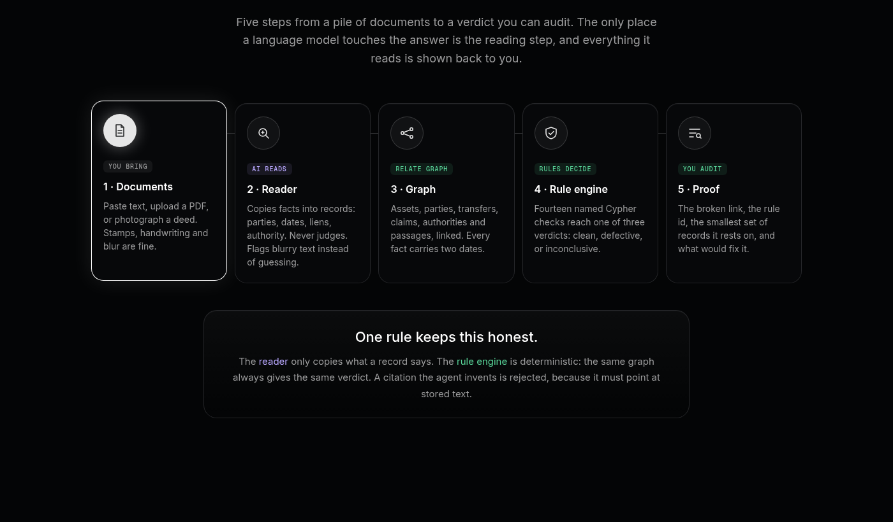
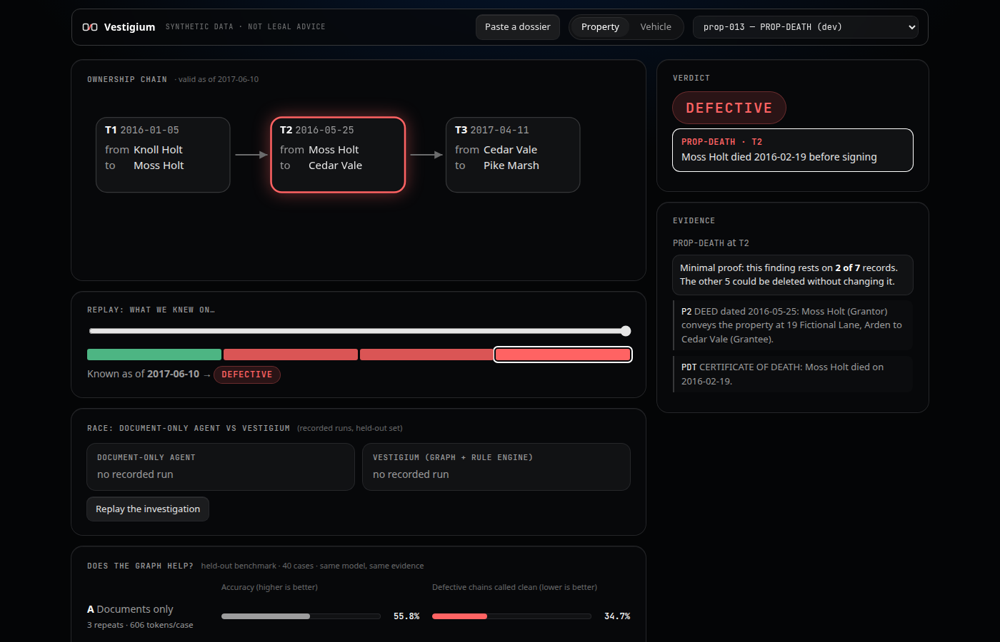

# Vestigium

**Every transfer in an ownership chain, checked against the evidence it needed at the time.**
Vestigium rebuilds the history of a property or a vehicle, runs deterministic checks on every sale, and shows the broken link together with the exact record that proves it.
Built on [Relate by Neo4j](https://relatedb.ai).


> All data is **synthetic**: fictional parties, a fictional jurisdiction, generic rules. Nothing here is real, and nothing here is legal advice.

**Open the overview:** `uv run python -m vestigium.serve`, then <http://127.0.0.1:8000/>. The app is at <http://127.0.0.1:8000/app.html>.

---

## What it is, in plain words

Before money changes hands on a property or a vehicle, someone has to be sure the seller could actually sell. Defects hide in the *connections* between records, not in any single one:

- a deed signed by an agent whose **power of attorney had already expired**,
- a **lien that was never released** before the sale,
- a **salvage brand that vanished** from a later vehicle title,
- a seller who was **never the previous buyer**, or a deed dated before the seller owned the property.

A person (or an AI) skimming the pile of documents tends to call such a chain "clean". Vestigium reads the documents into a graph, checks every transfer with named rules, and returns one of three verdicts:

| Verdict | Meaning |
|---|---|
| **clean** | every transfer links to the one before it, and no check finds a defect |
| **defective** | a check fails; the answer names the rule, the transfer and the records that prove it |
| **inconclusive** | a record is missing; the answer names it and accuses no one |

**The principle that keeps it honest: the AI reads, the rules decide.** A language model may *read* documents into structured facts, and every fact it read is shown back to you. It never judges legality. Every verdict comes from a deterministic rule engine: the same graph always gives the same answer, and a citation that points at text that does not exist is rejected.

## How it works


1. **Documents.** Paste text, upload a PDF, or photograph a deed (stamps, handwritten notes and blur included).
2. **Reader.** An offline regex reader handles canonical wording; a language model handles anything else; a vision model reads scans and reports how sure it is.
3. **Graph.** Facts land in one Relate graph: `Asset`, `Party`, `Transfer`, `Claim`, `Authority`, `Document`, `Passage`, linked by `FROM`, `TO`, `MOVES`, `FOLLOWS`, `AGAINST`, `CLEARED_BY`, `ACTED_UNDER`, `EVIDENCED_BY`, and more. **Every fact carries two dates**: when it took effect and when it was recorded.
4. **Rule engine.** Fourteen named Cypher checks (eight for property, six for vehicles). Gap rules produce *inconclusive*; the rest produce *defective*.
5. **Proof.** The verdict comes with its trail: verdict → rule id → graph path → evidence → exact document passage, the *smallest set of records* it rests on, and *what record would fix it*.



## Why Relate, and why single-file mode

Ownership is a chain of *relationships*: who gave up the asset, who received it, what authority the signer had, which claim was open. "Was the grantor the previous grantee?" and "was a lien released before this sale?" are graph patterns, so each rule is a short Cypher query on Relate, and the app lets you see exactly that: the graph itself, each rule's query, and what happens when you delete a relationship (see *The graph, live*). We store the demo graph in single-file mode, `vestigium.rl`: persistent, one file a judge can open and inspect, no server. Each benchmark case is built in its own in-memory graph, so every case is isolated, and "what would fix it" copies a graph into a throwaway instance to rehearse a hypothetical record.

## Quick start

```bash
git clone https://github.com/samuel025/vestigium && cd vestigium
uv sync                                   # installs relate-db (Relate's Python package), google-genai, mcp, pillow
cp .env.example .env                      # only for the LLM parts; add GEMINI_API_KEY (several keys can be rotated)
uv run pytest -q                          # 38 tests, no network needed
uv run python -m vestigium.build_store    # writes vestigium.rl and answer_key.json
uv run python -m vestigium.serve          # overview at http://127.0.0.1:8000/ , app at /app.html
uv run python -m vestigium.cli prop-014   # one case in the terminal: verdict, rule, evidence, fix, timeline
```

Inspect the persistent store with any Relate client:

```python
import relate; db = relate.connect("vestigium.rl")
db.execute("MATCH (t:Transfer)-[:ACTED_UNDER]->(a:Authority) RETURN t.id, a.agent, a.valid_to").data()
```

Everything runs offline except the LLM parts (benchmark arms A to C, the Gemini reader, scan reading). `uv run python -m vestigium.serve` serves the UI, the paste and upload endpoints, and the graph lab's custom-query endpoint; `cd demo && python3 -m http.server 8000` serves the static pages only.

## What you can do with it



| | |
|---|---|
| **Verdicts with a proof trail** | verdict → rule id → graph path → evidence → exact passage, in the UI and over MCP |
| **Minimal proof** | the smallest set of records a finding rests on (1.8 of a 10.3-record dossier on average) |
| **The graph itself** | the real nodes and relationships, a Cypher console with the exact rule queries (and your own, read-only), a chain walk, and *remove a relationship* to watch the verdict change |
| **Two-date replay** | slide the *known-as-of* date and watch the verdict change, e.g. clean until a late-recorded deed arrives |
| **What would fix it** | copy the graph, add a hypothetical record (a release, a ratifying authority, a missing link), rerun every check |
| **Honest "inconclusive"** | a missing record is named, never guessed |
| **Paste a dossier** | any wording; a reader extracts, the rules decide; every extracted fact is listed to check |
| **Scanned documents** | PDFs and photos, with per-record confidence carried into the verdict |
| **Replay the investigation** | real agent transcripts, tool call by tool call, with every citation checked against the store |
| **MCP server** | any MCP client can send records and get a verdict, rule ids and exact cited text |


**Rule packs** (`vestigium/rules.py`): *Property*: PROP-CHAIN, PROP-DUP, PROP-LIEN, PROP-AUTH, PROP-DATE, PROP-DEATH, PROP-GAP, PROP-AUTH-MISSING. *Vehicle*: VEH-OWN, VEH-LIEN, VEH-BRAND, VEH-ODO, VEH-GAP, VEH-ODO-MISSING.

### The graph, live


The app shows the case as the graph Relate actually holds. Click any transfer, party or line to inspect it; **Walk the chain** traverses `FOLLOWS` from the newest transfer back to the root, checking each link and each signing authority. Every rule has a tab with its exact Cypher and the rows it returns on this case; click a row to light up the nodes it matched. You can edit a query and run your own (read-only, on a throwaway in-memory copy; needs `uv run python -m vestigium.serve`).

The strongest demo: select a `FOLLOWS`, `ACTED_UNDER` or `CLEARED_BY` line and **remove it**. On a clean chain, dropping one `FOLLOWS` makes `PROP-GAP` fire and the verdict turns *inconclusive*; on `prop-014`, dropping the authority link replaces the `PROP-AUTH` defect with `PROP-AUTH-MISSING`. The engine reports what is now missing instead of guessing. Outcomes for every removable relationship of all 80 cases are precomputed, so this works on static hosting too. Deep links: `app.html?case=prop-014&remove=T5>ACTED_UNDER>AU1`, `&walk=1`, `&graph=1`, `&tab=rule:PROP-GAP`.

## Benchmark

80 synthetic cases from a fixed seed (`vestigium/generator.py`): **60 property** (40 defective incl. 5 adversarial, 10 clean, 10 inconclusive) and
**20 vehicle** (12 defective, 4 clean, 4 inconclusive). Chains run 3–12 transfers with distractor documents; the hard tier includes expired powers of attorney
and a misleading "title is clear" summary. Every third property case plus all vehicle cases (**40**) are the **held-out** set that the headline numbers use.
The answer key is `answer_key.json`; the planted error for each case is listed there.

Four arms, same evidence, same model (`gemini-3.5-flash-lite`, temperature 0.2):

- **A** original documents only, no graph.
- **B** documents as a Relate graph; the agent writes its own read-only Cypher.
- **C** the full system: Relate graph + the rule engine's checks as tools.
- **D** the rule engine alone, no agent.

### Results (held-out, 40 cases)

| Arm | Repeats | Accuracy (mean ± spread) | False-clean¹ | Abstains correctly | Localizes defect | Fix type | Tokens / case |
|---|---|---|---|---|---|---|---|
| A: documents only | 3 | 55.8% ± 1.2 | 34.7% ± 1.9 | 14% | 0% | 27% | 606 |
| B: graph + own Cypher | 3 | 54.2% ± 6.2 | 33.3% ± 11.5 | 5% | 46% | 64% | 23,369 |
| C: graph + rule tools | 3 | 100% ± 0 | 0% | 100% | 100% | 100% | 2,486 |
| D: rules alone | 3 | 100% ± 0 | 0% | 100% | 100% | 100% | 0 |

¹ share of *defective* cases called clean, the worst error. Spread is the standard deviation of per-repeat accuracy. Citation validity: A 92%, B 87%, C 100%, D 100%.
Property and vehicle show the same pattern (A 55% / 57%, B 58% / 50%, C and D 100% / 100%). Raw answers, tool-call counts and tokens for every run are in `results/heldout.jsonl`; full transcripts (every tool call, its arguments and result) are recorded for 12 showcase cases in `results/traces.jsonl`.

**Reading it:** a graph by itself did not help (B is no better than A, at ~39× the tokens, and swings from 47.5% to 62.5% between repeats). Giving the agent the rule engine's checks did (A 56% → C 100%, false-clean 35% → 0%),
and it did so in every repeat. C matches D on every verdict; the agent's contribution is investigation and explanation, which this benchmark does not score.

### Paste a dossier: reading documents into the graph

The UI's **Paste a dossier** box takes deeds, titles, liens, powers of attorney, releases and death certificates, extracts the facts, and hands them to the same rule engine
(`vestigium/intake.py`, `extract.py`, `dossier.py`). The reader only *reads*: it never decides legality, every verdict still comes from the rules, and the extracted facts are listed
so a person can check them. Nothing that could not be read is called clean: an empty chain is *inconclusive* ("no ownership records could be read").

We score this stage too (`vestigium/intake_bench.py`, held-out 40 cases, 3 repeats). Dossiers are rendered from the gold graph with every fact stated in text; "messy" wording varies date formats,
abbreviates names ("G. Stone") and shuffles record order. The reader's output is rebuilt into a graph, the engine judges it, and the result is compared with the gold graph.

| Reader | Wording | Verdict accuracy | Defective called clean | Right finding at the right record | Records read exactly |
|---|---|---|---|---|---|
| Offline regex | canonical | 100% | 0% | 100% | 100% |
| Offline regex | messy | 17.5% | 2.7% | 2.5% | 5.4% |
| Gemini (`gemini-3.5-flash-lite`) | canonical | 100% | 0% | 100% | 100% |
| Gemini | messy | 100% | 0% | 100% | 99.6% |

What to take from it: wording variety breaks a pattern-matching reader, and a language model recovers it, with the rule engine still making the call. Honest caveats: the dossiers are synthetic and generated from the same
schema, so real scanned deeds would be harder (OCR noise, free-form clauses); a name that is only ever abbreviated in a dossier stays abbreviated, which is correct to copy and the scorer accepts.
We changed the extraction prompt once after seeing results on this same held-out set (the first prompt let the model invent a first name for "N. Stone", which wrongly broke 2 of 120 messy runs; we now tell it to copy
names exactly and let code match abbreviations). The first run is kept in `results/intake_v1_prompt.jsonl` (98.3% messy verdict accuracy). Raw runs, including each extracted record list, are in `results/intake.jsonl`.

### Scanned documents: PDFs and photos

Nobody types out a 20-page deed. The upload box (and `POST /api/scan`) accepts PDFs and JPEG, PNG or WebP photos (`vestigium/scan.py`). Stage 1 is a vision model that transcribes each page record by record, including clerk's stamps and handwritten notes, and reports a **confidence** (high, medium or low) with *what* it is unsure about. It copies; it never judges. Stage 2 sends the transcript through the same reader, graph and rule engine.

**Confidence is carried into the verdict.** If a finding rests on a record that was read with low confidence, the verdict card says which record and page to check against the original, instead of guessing silently. A CLEAN verdict with low-confidence records is warned about too, not presented as safe, and low confidence on an irrelevant record does not raise a false alarm. A record that looks like a deed or lien but cannot be parsed is never silently dropped: the verdict becomes *inconclusive* and names the unreadable record.

How we test it: `render_scan()` makes synthetic scans from our dossiers, in three tiers (a clean PDF, a phone photo with rotation, uneven lighting, blur and JPEG damage, and a poor photo), with the recording date appearing *only* as a red stamp or a handwriting-style note, as on a real recorded deed. "Try a sample phone photo" in the app renders one and reads it.

**Status, stated plainly:** the scan benchmark (`uv run python -m vestigium.scan_bench`, 40 held-out cases per tier) was cut off by the free-tier daily quota. So far only the clean-PDF tier has run (25 of 40 cases): 100% correct verdicts and every date read exactly. The phone and poor-photo tiers, and whether the low-confidence flags catch real misreadings, are **not measured yet**; `results/scan.jsonl` is resumable and the numbers will be added here. Scans use `gemini-3.5-flash` (`VESTIGIUM_VISION_MODEL`), because the lite model returned overload errors on multi-page images. Tested only on synthetic pages: true handwriting, real scanner noise, and dedicated OCR services (Google Document AI, AWS Textract) are untested.

### Use it from your own agent (MCP)

`vestigium/mcp_server.py` serves the engine over the Model Context Protocol, so Claude Desktop, Claude Code or any MCP client can investigate a chain. Your model *reads* the documents and sends structured
records; the server *decides* with the deterministic rule engine and returns the verdict, rule ids, and the exact text of every cited record. Tools are read-only and need no API key: `rules`, `list_cases`,
`read_dossier`, `check_case` (with `as_of` / `known` dates), and `check_records` (a dossier your model has read). Invalid input is rejected, not guessed at.

```bash
claude mcp add vestigium -- uv run --directory /path/to/vestigium python -m vestigium.mcp_server
# Claude Desktop: add {"command": "uv", "args": ["run", "--directory", "/path/to/vestigium", "python", "-m", "vestigium.mcp_server"]} under mcpServers
```

Then ask: *"Use vestigium to check the dossier for prop-014 and explain the verdict."* A test drives it over a real stdio MCP connection (`tests/test_mcp.py`). This serves the *rule engine*; it is not Relate's own
`relate serve` MCP endpoint for the `.rl` store, which we did not test.

### Minimal proof: what a finding actually rests on

For every finding the engine also computes its **minimal proof** (`vestigium/proof.py`): it deletes facts from the graph (transfers, claims, authorities, links, death records), keeping each deletion only if the
finding still fires, until no single fact can go. What is left is sufficient and necessary: the finding fires on those facts alone and disappears if any one is removed, and every other record could be deleted without
changing it. Across the 70 findings in the 80 cases the proof averages **1.8 records out of a 10.3-record dossier** (17.5%, never more than 2). It is deterministic, needs no LLM, and the UI shows it on the Evidence card.

It also audited our own citations and found a real bug: in **33 of 70 findings** the rule's cited evidence left out a record the proof needs (for example a death-before-signing finding cited the deed but not the death
certificate; a lien finding cited the mortgage but not the sale it clouds). The rules now cite every record their proof rests on, and `tests/test_proof.py` checks that each proof is sufficient, minimal, and fully cited.
(The recorded agent runs predate this fix; the agents' answers were scored on verdicts and valid citations, which it does not change.)

### Robustness checks (no LLM, no answer key needed for the first two)

Because the rules and the generator were written together, we also test the rule engine on its own (`vestigium/metamorphic.py`, `tests/test_metamorphic.py`, run the big sweep with `uv run python -m vestigium.metamorphic`):

- **Invariance:** for every case we shuffle record order, rename every id, rename every party, shift every date by a constant, and add unrelated records (including a second, broken asset). The verdict, the rule that fired, the transfer and the cited passages must not change. **1,440 checks on 240 fresh cases: 0 failures** (plus 480 on the 80 benchmark cases).
- **Fresh seeds:** 20 new generator seeds (**1,600 cases** the rules were never tuned on) must match the planted labels. **0 failures.**

These tests found two real problems, now fixed, which is why they are worth running:
1. `PROP-DUP` picked "the duplicate" by string order of ids, so with arbitrary real-world ids it could blame the wrong transfer. It now uses the effective and recorded dates (id is only the final tie-break).
2. In 2 of 1,600 fresh cases the generator chose an `as_of` earlier than a planted record's recorded date, so the engine, correctly, could not know about it yet. The generator now judges with full knowledge. Existing benchmark cases are unchanged.

What this does *not* show: that the rules are right for any real jurisdiction. It shows the engine is deterministic, order- and name-independent, and does what its rules say.

### Limitations — please read

- **Arm B is noisy.** Its three repeats scored 52.5%, 62.5% and 47.5%, so its spread is wide; the free-tier quota meant B (about 12.6 requests per case) took two days to finish. Rerun with
  `./run_benchmark.sh` (`REPEATS=3`); it resumes and fills the gaps. One C case (prop-011) failed on a malformed answer in the first run; we removed that row, added a JSON repair retry to the harness
  and reran it (correct in all 3 repeats). Across the 120 C runs the repair retry fired once (prop-050, repeat 3) and the repaired answer was correct.
- **Small sample.** 40 cases (3 inconclusive and 4 clean per pack-side are few), one model, so the percentages for A and B are rough.
- **The rules and the generator were written together by the same people.** 100% for C and D is expected and is not evidence the rules are right for the real world. Arm D exists to show this: it is the ceiling of the rules themselves, and it is the agent-free baseline.
- **The held-out split is a flag, not a time gap.** Every third case is marked held-out and not used to tune; cases were not written after a rule freeze.
- **One small model.** A stronger model might narrow the gap for A and B.
- **Arms A-D assume a correct graph.** Extraction is scored separately (section above), not chained into the four-arm table. Not scored: per-case fix-by-copy accuracy for agent-proposed records
  (we score the *type* of record the agent names against the answer key; each answer-key fix is separately verified to turn its case clean).
- **The graph lab's edge removal is limited** to `FOLLOWS`, `ACTED_UNDER` and `CLEARED_BY` (the relationships the rules can notice); outcomes are precomputed for the 80 built-in cases, and editing or running your own Cypher, or removing from a pasted dossier, needs the local server. The query console is read-only by keyword filtering on a throwaway copy, a guard for a local demo, not a hardened sandbox.
- **Single-file Relate store only for the demo;** benchmark graphs are in-memory per case.
- **Scans are tested on synthetic photos only** (see *Scanned documents*), and that benchmark is not finished.
- Not built: running Relate in the browser (WASM), Relate's own `relate serve` MCP endpoint for the `.rl` store (our MCP server exposes the rule engine instead), Google Document AI or AWS Textract (we use a vision model).

## Layout

```
vestigium/rules.py        rule packs (Cypher)          vestigium/engine.py       load graph, run checks, verdict
vestigium/generator.py    seeded cases + answer key    vestigium/whatif.py       "what would fix it"
vestigium/proof.py        minimal proof sets           vestigium/metamorphic.py  invariance + fresh-seed checks
vestigium/dossier.py      full-fidelity dossier text   vestigium/extract.py      readers (regex, Gemini) + graph assembler
vestigium/intake.py       paste a dossier -> verdict   vestigium/scan.py         PDFs and photos -> text + confidence
vestigium/mcp_server.py   MCP tools                    vestigium/serve.py        local server: UI + paste + upload
vestigium/arms.py         benchmark arms A-D           vestigium/bench.py        scoring + report (resumable)
vestigium/intake_bench.py extraction benchmark         vestigium/scan_bench.py   scan benchmark (resumable)
vestigium/graphlab.py     read-only Cypher, remove-a-relationship experiments
vestigium/llm.py          Gemini wrapper: key rotation, pacing, tool loop, vision
demo/index.html           overview / landing page      demo/app.html             the app
demo/data.js, bench.js    exported data                vestigium.rl              persistent Relate store
results/heldout.jsonl     raw answers, call counts     results/traces.jsonl      full transcripts, 12 showcase cases
results/intake.jsonl      extraction runs              results/scan.jsonl        scan runs (partial)
answer_key.json           planted errors, all 80 cases docs/img/                  screenshots used above
```

## Product capabilities, third-party and AI tools

- **Product:** deterministic ownership-chain checks, evidence-cited verdicts, minimal proofs, a live graph view with a read-only Cypher console and remove-a-relationship experiments, replay by two dates, what-would-fix-it, paste and scan intake with confidence, an MCP server, a benchmark harness, and a web app with an overview page.
- **Third-party:** Relate (`relate-db`, embedded Cypher graph database), `google-genai`, `mcp`, `pillow`, `numpy`, `pytest`, `uv`.
- **AI tools:** Google Gemini powers benchmark Arms A to C and the readers (`gemini-3.5-flash-lite`) and scan reading (`gemini-3.5-flash`). The project was built with Claude Code (Anthropic) as the coding assistant.

## License

MIT, see `LICENSE`. All data in this repository is synthetic; nothing here is legal advice.
