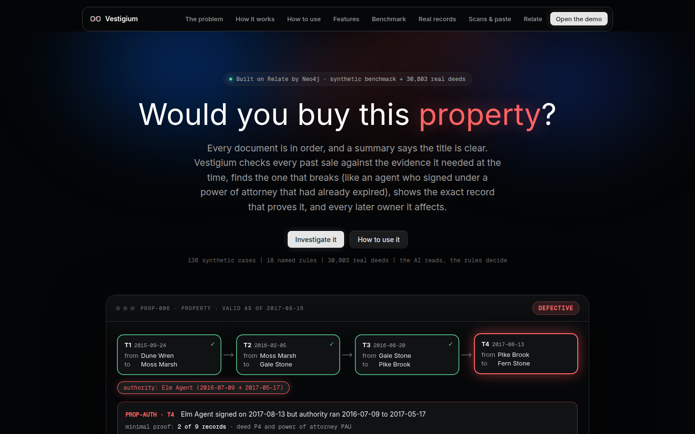
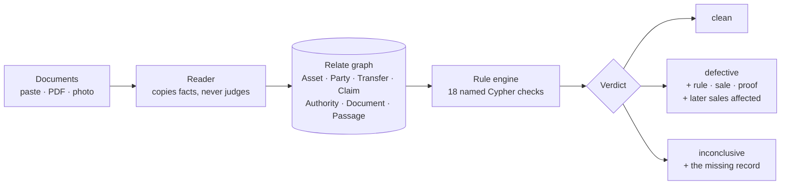
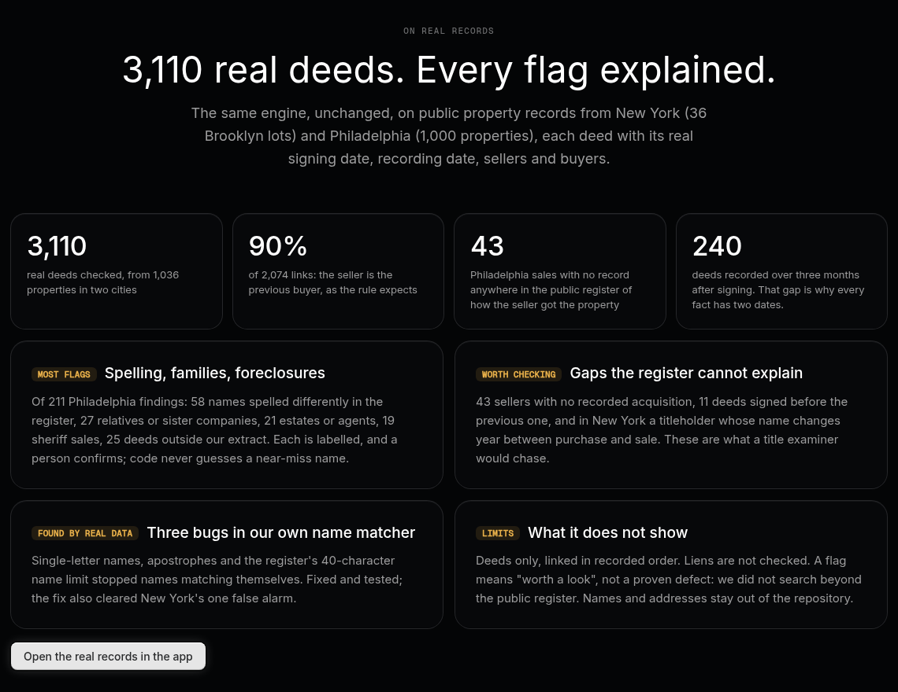

# Vestigium

**Would you buy this property?** Every document can look in order, and a summary can say the title is clear, while one sale years ago was never valid. Vestigium rebuilds the ownership history as a **Relate graph**, checks every past sale against the evidence it needed *at the time*, and tells you exactly where the chain breaks, which record proves it, and which later owners it affects. When a record is missing, it says so instead of guessing.

**▶ Try it, no install: [vestigium-demo.vercel.app](https://vestigium-demo.vercel.app/)** · [open a 60-second investigation](https://vestigium-demo.vercel.app/app.html?case=prop-014) · built on [Relate by Neo4j](https://relatedb.ai)



> **The AI reads. The rules decide.** A language model may read documents into facts, and shows you everything it read. It never judges. Every verdict comes from 18 named Cypher rules on a Relate graph: the same records always give the same answer, and every answer points at the exact text behind it.

### The evidence, in one table

| We tested it… | Result |
|---|---|
| against an AI agent reading the same documents | rule-backed agent **100%** vs **56%**; it called **0** defective chains clean (the plain agent: 1 in 3) |
| on 40 harder cases written *after* the rules were frozen | **100% in all 3 repeats**; the plain agent called a missing record "clean" **18 times out of 18** |
| on two model families (Gemini and Gemma) | **100%** with the rules, on both tiers, with both models |
| on 48 cases written by an independent author | **95.8%** end to end, **0** defective chains called clean, abstained on **every** missing record |
| on **30,803 real public deeds**, against blind human labels | caught **45 of 45** real breaks in the chain |
| against 1,600 fresh cases and 1,440 invariance checks | **0** misses, **0** failures |

Every number comes with raw runs in [`results/`](results/), a one-command rerun, and the losses reported next to the wins.

---

## One investigation, in 60 seconds

Open the [demo case](https://vestigium-demo.vercel.app/app.html?case=prop-014): 12 sales of one property, and a title summary saying it is clear.

1. **Would you buy it?** *"No, not on this evidence. The chain breaks at T5, and 7 later sales rest on it."*
2. **Where does it break, and what proves it?** Sale T5 was signed in May 2019 by an agent whose power of attorney had expired that January. The proof is **2 records out of 18**: the deed and the power of attorney, quoted word for word.
3. **Was the signer allowed?** Every question a title examiner would ask, each with ✓ or ✗: in force that day? granted by the seller? covers selling? revoked? signed by the named agent?
4. **What else does it break?** Seven later owners bought through T5. Their sales look clean; their title still rests on a broken one.
5. **What could you have known?** T5 was signed on 1 May and filed on 4 May. Anyone checking the register in between was told the chain was **clean**. Vestigium answers both questions: what was *true*, and what could be *known*.
6. **What would fix it?** A ratification by the seller, tested on a throwaway copy of the graph: the verdict turns clean.


## What makes it different

- **It investigates authority, not just documents.** Most broken chains break where someone signs *for* the owner. Five rules check the power of attorney the way a title examiner would, each as a graph pattern (`GRANTED_BY` must point at the seller; `REVOKED_BY` must not predate the signing, *as known on the date you ask*). [The rules →](docs/rules.md)
- **It follows the damage.** One broken sale is not the end of it: a graph walk along `FOLLOWS` marks every later sale whose chain of title passes through it.
- **It keeps two kinds of time.** Every fact has the date it took effect and the date it reached the register. Two controls and a verdict grid show the difference, which is exactly where buyers get caught out.
- **It says "I don't know" when it doesn't.** A missing record gives *inconclusive*, names the missing record, and accuses no one.
- **It proves things minimally.** Each finding comes with the smallest set of records it rests on (on average 1.8 of 10.3), and with the record that would fix it.
- **You can see the graph.** Every rule's exact Cypher with the rows it returns, a walk along the chain, and *remove a relationship* to watch the verdict change. Your own queries run on a store opened with Relate's `read_only=True`, so Relate itself refuses any write.

## Why Relate

Ownership *is* a graph: who sold, who bought, which sale each one follows, who signed under what authority, which claim was open. So every check is a short Cypher pattern on Relate, not a pile of Python. "Did the seller grant this power of attorney?" reads:

```cypher
MATCH (t:Transfer)-[:ACTED_UNDER]->(au:Authority)-[:GRANTED_BY]->(pr:Party), (g:Party)-[:FROM]->(t)
WHERE pr <> g AND NOT EXISTS { (t)-[:ACTED_UNDER]->(ok:Authority) WHERE ok <> au AND <ok is fully valid> }
RETURN t.id AS transfer, pr.name + ' granted the power of attorney, but ' + g.name + ' was the seller' AS detail
```

and "which later sales rest on this broken one?" is a single variable-length traversal:

```cypher
MATCH (later:Transfer)-[:FOLLOWS*1..60]->(t:Transfer {id:$t})
WHERE later.effective <= date($as_of) AND later.recorded <= date($known)
RETURN DISTINCT later.id
```

Each case lives in its own in-memory Relate graph. *What would fix it* copies the graph into a throwaway instance and adds a hypothetical record. The demo store is one persistent file, `vestigium.rl`, that anyone can open with a Relate client.



| Verdict | What it means |
|---|---|
| **clean** | every sale follows from the one before it, and no rule finds a problem |
| **defective** | a rule found a problem: which rule, which sale, the records that prove it, and the later sales that rest on it |
| **inconclusive** | a record that should exist is missing: which one, and no one is accused |

## The results

### 1. A graph alone does not make an AI agent reliable. A graph with deterministic checks does.

Same model (`gemini-3.5-flash-lite`), same evidence, held-out synthetic cases, 3 repeats each:

| | Main benchmark (40 cases) | Hard tier (40 cases written *after* the rules were frozen) |
|---|---|---|
| A: documents only | 55.8% · calls 35% of defective chains clean | 72.5% · calls a missing record **clean 18 times out of 18** |
| B: graph, agent writes its own Cypher | 54.2% · at 39× the tokens of A | 48.3% · calls 47% of defective chains clean |
| **C: graph + rule engine as tools** | **100% · 0 defective chains called clean** | **100% in all 3 repeats · abstains on every missing record** |

Giving the agent the graph and letting it write its own Cypher did *not* help. Giving it the rules did. The hard tier holds the cases that trip people up: two defects in one chain, sound chains that look suspicious, a missing record under a "title is clear" summary, a power of attorney that does not cover a sale, contradictory filings, and an early defect followed by a long run of clean sales. The rules were frozen, with fingerprints the benchmark checks, *before* those cases existed.

**Not a quirk of one model.** Rerun with **Gemma 4 26B**, a different model family: documents only 66.7% (held-out) and 77.5% (hard tier, never abstaining on a missing record); with the rule engine as tools, **100% on both tiers and no defective chain called clean**. [Full benchmark →](docs/benchmark.md)

### 2. It works on cases we did not write

So we are not grading our own homework, another model wrote **48 property files** from one-line, plain-English situations, never seeing our rules, record wording or schema, in its own formats, abbreviations and date styles, with "title is clear" cover letters thrown in.

| Independent author, 48 cases | Documents only (3 repeats) | **Vestigium end to end** |
|---|---|---|
| Accuracy | 84.0% | **95.8%** |
| Defective chains called clean | 12.5% | **0%** |
| Abstains on a missing record | 87.5% | **100%** |
| Unreleased mortgage | 0% | **100%** |

Both of Vestigium's misses are audited and published: one is our name matcher not expanding "Wm." to "William" (left unfixed, so the number stays honest), the other a case whose answer key is debatable. [Details →](docs/benchmark.md#cases-written-by-an-independent-author)

### 3. It runs on real records

The unchanged engine checked **30,803 real public deeds** from New York and Philadelphia (about 10,000 properties). 90% of seller-to-buyer links match; every flag falls into an explainable kind (a name spelled two ways, an estate selling, a foreclosure), and **445 sales have no record anywhere in the public register of how the seller got the property**, exactly what a title examiner chases. Real data also found bugs in our own name matching, now fixed and tested.

**A blind test.** Public registers publish no answer key, so a person labelled 150 real Philadelphia links (half the engine flagged, half it accepted, shuffled, engine answers hidden): is the seller the previous buyer?

| Against blind human labels | Accuracy | Real breaks caught | False alarms |
|---|---|---|---|
| Rule engine alone | 80.0% | **45 of 45** | 30 (every one a register typo: "SEMMELRITH"/"SEMMELROTH") |
| Gemini reading the names alone | 93.9% | 43 of 45 | 7 (some on identical names) |
| **Rules decide, AI labels each flag** | rules' verdicts | **45 of 45** | 30, of which **27 arrive labelled "probable spelling variant"** |

The rules never let a real break through; the AI reads messy names better but misses breaks and invents others. With the rules deciding and the AI only annotating, nothing is missed and almost every false alarm is pre-sorted for a quick human check. [Real records →](docs/real-records.md)



### 4. It is hard to fool

1,600 freshly generated cases the rules were never tuned on: 0 misses. 1,440 invariance checks (shuffle the records, rename everyone, shift every date, add noise): 0 failures. Documents in messy wording are read correctly 100% of the time by the Gemini reader (17.5% by a pattern matcher), and every scan is read twice so a confident misread gets caught. [Reading documents →](docs/reading-documents.md)

## How to use it

**In your browser.** Open [the app](https://vestigium-demo.vercel.app/app.html) and follow the **Investigate** buttons. Switch between **Property**, **Vehicle** and **Real** (anonymised real deeds), or pick a case from the *Power of attorney, in depth* and *Hard tier* groups. Press **?** for a guide to every panel.

**On your own documents.**

```bash
git clone https://github.com/samuel025/vestigium && cd vestigium
uv sync                                  # Python 3.12+
cp .env.example .env                     # optional: a free GEMINI_API_KEY to read messy text, PDFs and photos
uv run python -m vestigium.serve         # then open http://127.0.0.1:8000/app.html → Paste or upload
```

**From your own AI assistant (MCP).** `claude mcp add vestigium -- uv run --directory /path/to/vestigium python -m vestigium.mcp_server`, then ask it to check a dossier. Your assistant reads; Vestigium's rules decide. [Details →](docs/using-it.md)

**Check our claims.** `uv run pytest -q` (78 tests, no network) · `uv run python -m vestigium.bench --arms D --split hard` · `uv run python -m vestigium.philly fetch --n 10000 && uv run python -m vestigium.philly`

<details><summary><b>Words you will see</b></summary>

| Word | Meaning |
|---|---|
| **Chain** | the list of sales of one property or vehicle, oldest first |
| **Grantor / grantee** | the seller / the buyer on a deed |
| **Lien** | a claim on the property, usually a loan, that should be released before a sale |
| **Power of attorney** | written permission for someone to sign for the owner, valid only between set dates |
| **Recorded** | the date a deed reached the public register, often weeks after it was signed |
| **Rule** | one named check, e.g. `PROP-CHAIN`: the seller must be the previous buyer ([all 18](docs/rules.md)) |

</details>

## Honest limits

- **The main benchmarks are synthetic, and the rules and cases share an author.** So 100% there shows the engine does what its rules say. That is why the hard tier was written after a rule freeze, why 48 cases were written by an independent author (95.8%), and why the chain rule is measured on real records against blind human labels. The independent author was another Gemini model, not another model family.
- **Real records can only test the chain and date rules.** Public registers hold neither a power of attorney's terms nor which payoff released which mortgage, so the authority and lien rules are tested on synthetic and independently written cases. The blind test has one labeller and 150 links; a flag on real data means "worth a look", not a proven defect.
- **Small samples, small models:** 40 + 40 held-out cases and 48 independent ones, on free-tier Gemini and Gemma; the own-Cypher arm ran on Gemini only (Gemma's free tier was overloaded).
- **Scans are tested on synthetic pages:** clean PDFs and phone photos read perfectly; poor photos are right 95–97.5% of the time, and a misread both reads share still gets through.
- **Not legal advice.** The rules are generic and the jurisdiction is fictional.

[All limitations →](docs/benchmark.md#limitations--please-read)

## More

[Benchmark](docs/benchmark.md) · [Real records](docs/real-records.md) · [The rules](docs/rules.md) · [Reading documents and scans](docs/reading-documents.md) · [The graph lab, MCP and the code](docs/using-it.md) · [Demo script](DEMO_SCRIPT.md)

**Built with** Relate (`relate-db`, embedded Cypher graph database) · Python · Google Gemini and Gemma (agent arms, readers, independent author) · NYC Open Data and OpenDataPhilly (public records, anonymised here) · Firecrawl (one-off download of the NYC records) · built with Claude Code (Anthropic).

**License** MIT, see [`LICENSE`](LICENSE). Benchmark cases are synthetic; real records are public and anonymised before anything is committed. Nothing here is legal advice.
