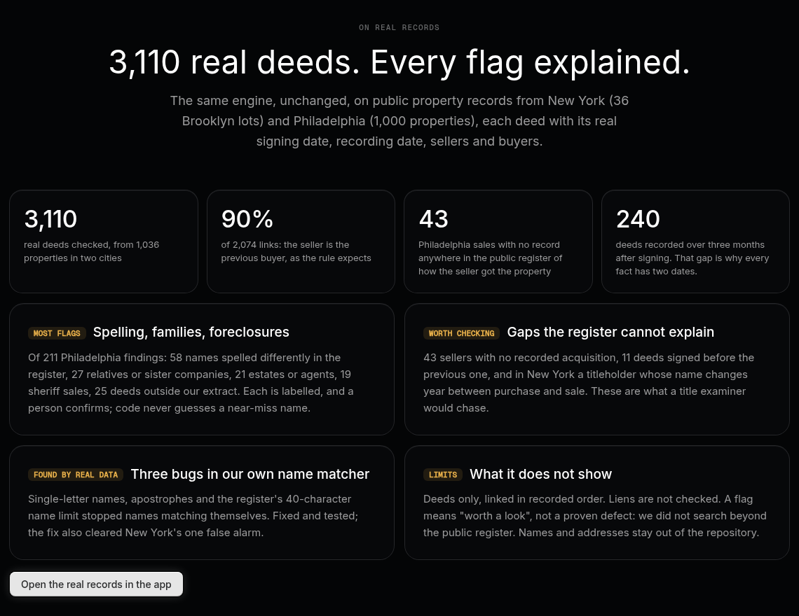

# Real records: 30,803 deeds from two cities

How the unchanged rule engine behaves on real public property records from New York and Philadelphia, what it flagged, what we checked by hand, and how to reproduce it.

[← back to the README](../README.md)

## Real records: 30,803 deeds from two cities

**In short:** we ran the unchanged rules on about 10,000 real properties. 9 in 10 sales link up cleanly. Most of the rest are explained by ordinary things (a name spelled differently, an estate selling, a foreclosure), and each is labelled. About 1 break in 5 has **no record anywhere in the public register** of how the seller got the property; those are exactly what a person should look into.

Two importers feed real public deeds into the same graph and the **unchanged** rule engine:

- **New York** (`vestigium/acris.py`): NYC ACRIS, the city's register (NYC Open Data). 5 adjacent Brooklyn blocks: 36 lots, 90 deeds, 2003–2026.
- **Philadelphia** (`vestigium/philly.py`): the city's Real Estate Transfer Tax records (OpenDataPhilly, `rtt_summary`). A repeatable pseudo-random sample of **9,999 properties, 30,713 deeds**, all years on record, including sheriff's (foreclosure) deeds.

Each deed brings its two real dates (signed, recorded) and its seller and buyer names.

**See it in the app:** the **Real** tab opens all 36 New York lots and 38 Philadelphia properties chosen to show every kind of finding (e.g. `app.html?case=real-8`, `app.html?case=phl-d81620`), anonymised: owners are numbered, no names, addresses or parcel numbers. Each has the same chain view, proof, time travel and graph lab as the synthetic cases, plus a note saying why it was flagged.

| | New York | Philadelphia |
|---|---|---|
| Properties / deeds / seller-to-previous-buyer links | 36 / 90 / 54 | 9,999 / 30,713 / 20,714 |
| Seller matched the previous buyer | 53 of 54 | 18,630 of 20,714 (90%) |
| Verdicts | 35 clean, 1 defective | 8,210 clean, 1,789 defective |
| Deeds recorded more than 90 days after signing | 12 of 90 | 2,560 of 30,666 (443 over a year) |

**What the flags were.** The one New York flag was read by hand: a real register inconsistency (a buyer recorded as an exchange titleholder "...2006-175" sells as "...2007-175"). In Philadelphia the importer sorts each of the 2,202 findings by a stated rule, and for unexplained breaks it searches the **full** register (every document type, multi-property deeds) for a record of how the seller acquired the property:

| Philadelphia finding | Count | In plain words |
|---|---|---|
| Probable spelling variant (85%+ similar) | 617 | The same person or company spelled differently ("KRZSYTOF" / "KRZYSZTOF"). A person confirms; code does not guess |
| No record of how the seller acquired it | 445 | Nothing in the public register gives the property to the seller. This is what a title examiner chases |
| A deed to the seller exists outside our extract | 262 | Our importer only read single-property deeds; the engine correctly said the chain *it was given* was broken |
| Sheriff sale (foreclosure) | 244 | A lawful break the synthetic rules do not model; 144 properties are "defective" only because of one |
| Estate, trust or agent sells | 231 | An executor, trustee or attorney-in-fact signs. Lawful with the right authority, which the register does not hold |
| Related name, different party | 210 | A spouse, relative, co-owner or sister company sells. Usually explainable, but it needs a document |
| Signed before the previous deed was signed | 119 | Recorded out of order (`PROP-DATE`): the order of events is not what the register suggests, or a seller conveyed before acquiring |
| The seller appears only as a borrower | 74 | They took a loan against the property, but no deed to them is on record |

We read random samples by hand (drawn from the first 1,000 properties, which are part of this sample): 20 of the name group (about 15 spelling variants, 5 related parties) and 15 of the unexplained group (1 alias, "Fannie Mae" vs "Federal National Mortgage Association"; 2 a builder or the city; 12 with no acquisition record we could find). The category shares at 1,000 and at 10,000 properties are nearly identical.

**Real data found bugs in our code**, which is why we test on it: names made of single letters ("S E B M INC"), apostrophes ("ROSHA'S" / "ROSHAS") and names cut at the register's 40-character limit did not match themselves, and one deed carries the impossible date "206-05-07". All fixed and tested; the name fixes also cleared New York's one false alarm (a surname written "LA PIERRE" when the couple bought and "LAPIERRE" when they sold). Near-miss spellings are still never accepted automatically.

**What it shows:** the rule engine runs unchanged on 30,803 real deeds in about a minute and a half; its flags fall into a few explainable kinds; and recording delays are common (1 deed in 12 took over three months), so the two-date model matters. **What it does not show:** that any flagged property has an actual title defect (we did not search beyond the public register), or anything about liens: a satisfaction is not linked to its mortgage in the fields we read, and mortgages are routinely satisfied weeks after a sale. Deeds are linked in recorded order because neither register says which earlier deed a seller acquired through.

**Privacy and reproduction.** Raw downloads hold real names and stay in `data/acris_raw/` and `data/philly_raw/` (gitignored); the committed reports (`results/acris_real.json`, `results/philly_real.json`) and the app data (`demo/real.js`) carry no names, addresses or parcel numbers (app ids are one-way hashes). Philadelphia: `uv run python -m vestigium.philly fetch --n 10000` (about 3 minutes, free public API) then `uv run python -m vestigium.philly` (about 5 minutes including the register lookups). New York: fetch the lots from Real Property Legals (e.g. `https://data.cityofnewyork.us/resource/8h5j-fqxa.json?$where=borough=3 AND block between 5200 and 5204&$limit=5000`), then those documents' rows from Master (`bnx9-e6tj`) and the deeds' parties from Parties (`636b-3b5g`) with `$where=document_id in(...)`; save them as `legals.json`, `master.json` (keyed by `document_id`) and `parties.json` in `data/acris_raw/`, and run `uv run python -m vestigium.acris`, which also rebuilds `demo/real.js`. (The NYC API refused our network, so we fetched those pages through Firecrawl's scraper; the data is the same public API response.)
