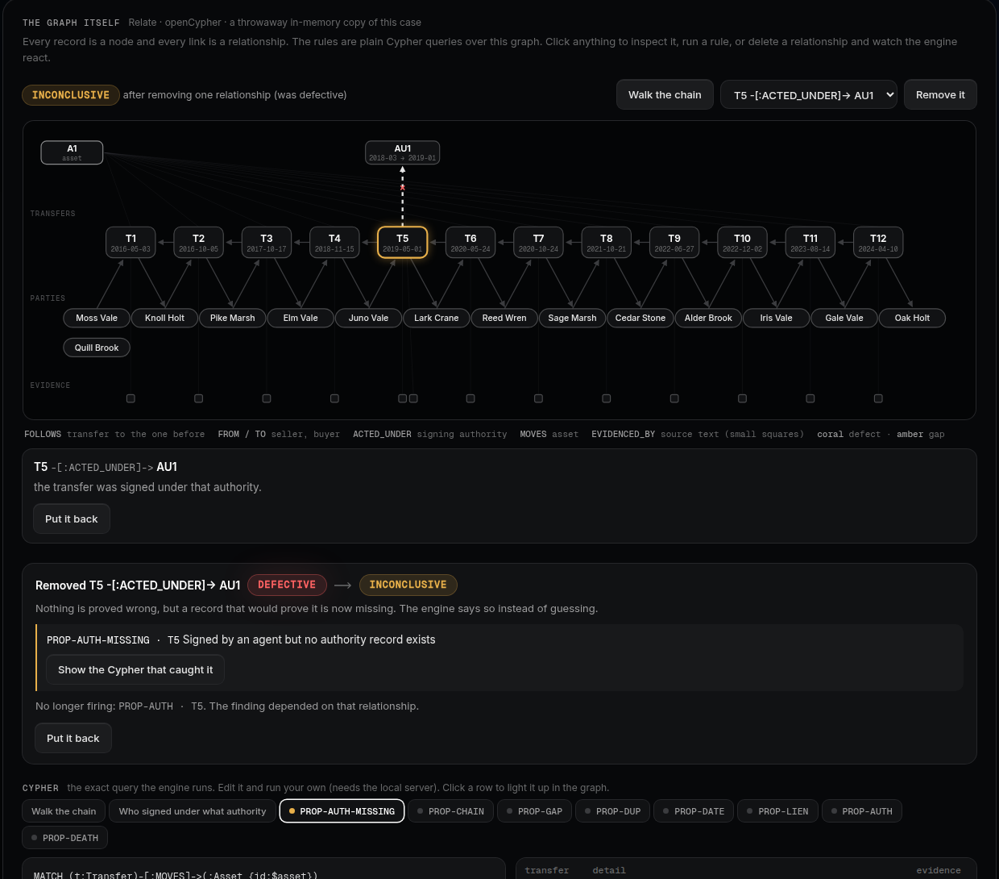

# Using it: the app, the graph lab, MCP and the code

Everything about running and extending Vestigium: the graph lab, connecting it to your own AI assistant over MCP, running it locally, and where the code lives.

[← back to the README](../README.md)

## The graph, live



The app shows the case as the graph Relate actually holds. Click any transfer, party or line to inspect it; **Walk the chain** traverses `FOLLOWS` from the newest transfer back to the root, checking each link and each signing authority. Every rule has a tab with its exact Cypher and the rows it returns on this case; click a row to light up the nodes it matched. You can edit a query and run your own (on a throwaway Relate store opened read-only, so any write is refused by Relate itself; needs `uv run python -m vestigium.serve`).

The strongest demo: select a `FOLLOWS`, `ACTED_UNDER` or `CLEARED_BY` line and **remove it**. On a clean chain, dropping one `FOLLOWS` makes `PROP-GAP` fire and the verdict turns *inconclusive*; on `prop-014`, dropping the authority link replaces the `PROP-AUTH` defect with `PROP-AUTH-MISSING`. The engine reports what is now missing instead of guessing. Outcomes for every removable relationship of all 80 cases are precomputed, so this works on static hosting too. Deep links: `app.html?case=prop-014&remove=T5>ACTED_UNDER>AU1`, `&walk=1`, `&graph=1`, `&tab=rule:PROP-GAP`.

## Use it from your own agent (MCP)

`vestigium/mcp_server.py` serves the engine over the Model Context Protocol, so Claude Desktop, Claude Code or any MCP client can investigate a chain. Your model *reads* the documents and sends structured
records; the server *decides* with the deterministic rule engine and returns the verdict, rule ids, and the exact text of every cited record. Tools are read-only and need no API key: `rules`, `list_cases`,
`read_dossier`, `check_case` (with `as_of` / `known` dates), and `check_records` (a dossier your model has read). Invalid input is rejected, not guessed at.

```bash
claude mcp add vestigium -- uv run --directory /path/to/vestigium python -m vestigium.mcp_server
# Claude Desktop: add {"command": "uv", "args": ["run", "--directory", "/path/to/vestigium", "python", "-m", "vestigium.mcp_server"]} under mcpServers
```

Then ask: *"Use vestigium to check the dossier for prop-014 and explain the verdict."* A test drives it over a real stdio MCP connection (`tests/test_mcp.py`). This serves the *rule engine*; it is not Relate's own
`relate serve` MCP endpoint for the `.rl` store, which we did not test.

## Running it locally: details

See *How to use it* in the [README](../README.md#how-to-use-it) for the commands. Inspect the persistent store with any Relate client:

```python
import relate; db = relate.connect("vestigium.rl")
db.execute("MATCH (t:Transfer)-[:ACTED_UNDER]->(a:Authority) RETURN t.id, a.agent, a.valid_to").data()
```

Everything runs offline except the LLM parts (benchmark arms A to C, the Gemini reader, scan reading) and the one-off download of the real NYC records. `uv run python -m vestigium.serve` serves the UI, the paste and upload endpoints, and the graph lab's custom-query endpoint; `cd demo && python3 -m http.server 8000` serves the static pages only.

## Layout

```
vestigium/rules.py        rule packs (Cypher)          vestigium/engine.py       load graph, run checks, verdict
vestigium/generator.py    seeded cases + answer key    vestigium/whatif.py       "what would fix it"
vestigium/proof.py        minimal proof sets           vestigium/metamorphic.py  invariance + fresh-seed checks
vestigium/dossier.py      full-fidelity dossier text   vestigium/extract.py      readers (regex, Gemini) + graph assembler
vestigium/intake.py       paste a dossier -> verdict   vestigium/scan.py         PDFs and photos -> text + confidence
vestigium/mcp_server.py   MCP tools                    vestigium/serve.py        local server: UI + paste + upload
vestigium/arms.py         benchmark arms A-D           vestigium/bench.py        scoring + report (resumable)
vestigium/intake_bench.py extraction benchmark         vestigium/scan_bench.py   scan benchmark (resumable)
vestigium/graphlab.py     read-only Cypher, remove-a-relationship experiments
vestigium/acris.py        real NYC deeds (ACRIS) -> graph -> rules
vestigium/philly.py       real Philadelphia deeds -> graph -> rules
vestigium/llm.py          Gemini wrapper: key rotation, pacing, tool loop, vision
demo/index.html           overview / landing page      demo/app.html             the app
demo/data.js, bench.js    exported data (real.js: the anonymised real lots)                vestigium.rl              persistent Relate store
results/heldout.jsonl     raw answers, call counts     results/traces.jsonl      full transcripts, 12 showcase cases
results/intake.jsonl      extraction runs              results/scan_x2/           scan benchmark (double read)
answer_key.json           planted errors, all 80 cases docs/img/                  screenshots used above
```
